# PlantSync: Project Guide

PlantSync monitors plants with a NodeMCU (ESP8266) board and waters them automatically. The board
posts sensor readings to a Next.js web app. The app stores them in PostgreSQL and tells the board
when to run the pump. People watch and manage everything from a dashboard.

- [1. Tech stack](#1-tech-stack)
- [2. How it works](#2-how-it-works)
- [3. Getting started, step by step](#3-getting-started-step-by-step)
- [4. Login accounts](#4-login-accounts)
- [5. Pages](#5-pages)
- [6. Roles and permissions](#6-roles-and-permissions)
- [7. Device API](#7-device-api)
- [8. Hardware and firmware](#8-hardware-and-firmware)
- [9. Statuses and rules](#9-statuses-and-rules)
- [10. Screenshots](#10-screenshots)

## 1. Tech stack

| Layer | Tool |
|---|---|
| Microcontroller | NodeMCU v1.0 (ESP8266) |
| Firmware | C++ (Arduino sketch) in the Arduino IDE |
| Sensors | Capacitive soil moisture, DHT22 (temperature and humidity), BH1750 (light) |
| Watering | Relay module and water pump |
| Web app | Next.js 16, React 19, TypeScript, shadcn/ui, Tailwind 4 |
| Data fetching | TanStack Query, with nuqs for URL params and TanStack Form with Zod for forms |
| Charts | Recharts |
| Database | PostgreSQL through Prisma 7 |
| Auth | Signed session cookie (`jose`) with bcrypt passwords |
| Version control | Git |

## 2. How it works

```mermaid
%%{init: {"theme":"base","themeVariables":{"fontFamily":"Poppins, Arial, sans-serif","lineColor":"#000"}}}%%
flowchart TD
    S1(("·")) --> A1["Sensors are read<br/>(moisture, DHT22, BH1750)"]
    A1 --> A2["NodeMCU posts the reading<br/>POST /api/store-sensor-values"]
    A2 --> A3[("Reading stored in PostgreSQL")]
    A3 --> A4["Dashboard polls and shows<br/>the latest status"]
    A4 --> A5["User watches plants<br/>and notifications"]
    A5 --> E1(("·"))
    classDef act fill:#fff,stroke:#000,stroke-width:1.5px,color:#000
    classDef dec fill:#fff,stroke:#000,stroke-width:1px,color:#000
    classDef dot fill:#fff,stroke:#000,stroke-width:1.5px,color:#fff
    class A1,A2,A3,A4,A5 act
    class  dec
    class S1,E1 dot
```

**The watering loop, every few seconds:**

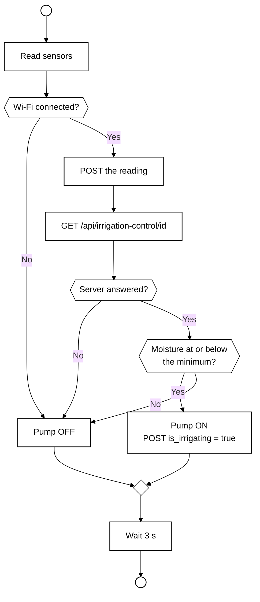

The pump is never left running when the board has no connection or gets no answer.

**Sign-in and access:**

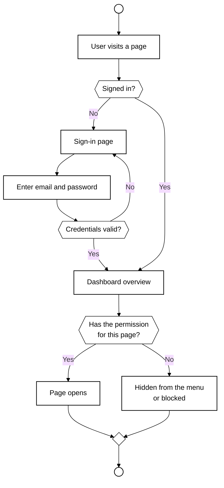

## 3. Getting started, step by step

1. **Install:** `bun install`. This also runs `prisma generate`.
2. **Configure:** copy `.env.example` to `.env`. Set `AUTH_SECRET` (32 or more characters, for example from
   `openssl rand -base64 48`), the PostgreSQL connection string, and optionally `DEVICE_API_KEY`.
3. **Create the tables:** `bunx prisma migrate deploy`.
4. **Add starter data:** `bun run db:seed`. This creates the default roles, the login accounts in
   section 4 and two demo plants.
5. **Run:** `bun dev`, then open <http://localhost:3000>.
6. **Sign in** with an account from section 4.
7. **Add a device:** Device Identifiers → New. Name it and design its wiring. Copy the generated ID.
8. **Add a plant:** Plants → New. Pick the device and set the moisture targets.
9. **Flash the board:** follow `docs/nodemcu-windows-setup.md` and put the device ID and your server URL in
   `esp32/nodemcu-plant-monitor.ino`.
10. **Watch it:** readings appear on the Dashboard and the plant's page within seconds.

Other commands: `bun run user:create "<name>" <email> '<password>' [Role]` creates or resets a user. It
is the way back in if you lose access to every admin account. The `lint`, `typecheck` and `format` scripts
check the code.

## 4. Login accounts

These are the **seed defaults** from `prisma/seed.ts`. They are the same on every fresh install, so
they are demo data only.

| Role | Email | Password | What they can do |
|---|---|---|---|
| Admin | `admin@example.com` | `password` | Everything, including users and roles |
| Operator | `operator@example.com` | `password` | Manage plants and devices, but not users or roles |
| Viewer | `viewer@example.com` | `password` | Read-only view of plants and devices |

- The admin's name, email and password can be changed with `SEED_USER_NAME`, `SEED_USER_EMAIL` and
  `SEED_USER_PASSWORD` in `.env` before seeding. The demo password comes from `SEED_DEMO_PASSWORD`.
- Set `SEED_DEMO_USERS=false` to skip the Operator and Viewer accounts.
- **Change these passwords, or skip the demo users, before any real deployment.** Do not put real
  credentials in this file.

## 5. Pages

Every `/dashboard/...` page needs a signed-in user. The sidebar shows only what the user's role allows.

### Sign-in (`/auth/sign-in`)
- **Purpose:** log in. A signed-in user who visits it is sent to the dashboard.
- **Fields:** email, password.
- **Result:** a session cookie, then the dashboard overview.

### Dashboard (`/dashboard/overview`)
- **Purpose:** live status of every plant. `/` and `/dashboard` both redirect here.
- **Shows:**
  - Summary figures, including how many waterings happened today.
  - One card per plant, with its device name, status and a moisture sparkline for the last 24 hours.
  - An "attention" area for plants that need water, are offline or have a sensor fault.
  - A 14-day irrigation chart of waterings per day.
- **Updates:** by polling, so values refresh without a reload.
- **Notification bell** (header, every page): shows a toast and keeps a list when a plant changes status.
  A burst of changes shows one summary toast. Alerts are kept in the browser, with the same alert not
  repeated within 10 minutes.

### Plants (`/dashboard/plants`)
- **Purpose:** the list of plants and their irrigation targets. Needs `view:plants`.
- **Table:** searchable and sortable, with edit and delete actions.
- **New plant:** a side form with Device identifier, Name, Moisture min (%) and max (%), Humidity (%),
  Temperature (°C) and Light intensity (lux). Needs `create:plants`.

### Plant detail (`/dashboard/plants/[plantId]/edit`)
- **Purpose:** live readings and targets for one plant.
- **Shows:**
  - The latest readings, board status and per-sensor health.
  - Waterings today.
  - A table of the last 30 readings.
  - The wiring diagram for the device.
- **Edit:** the same form as above. Needs `edit:plants`.
- **Delete:** a confirmation first. Needs `delete:plants`.

### Device Identifiers (`/dashboard/device-identifiers`)
- **Purpose:** the boards that report readings. Needs `view:devices`.
- **Table:** device name and ID, with edit and delete.
- **New and edit** (`/new`, `/[deviceId]/edit`): a Name field plus a **wiring designer**. Pick the board, add
  the sensors and relay, and the pins are laid out in a diagram you can follow when building the circuit.
  The ID is generated and is the value the firmware sends.

### Users (`/dashboard/users`)
- **Purpose:** the people who can sign in. Needs `view:users`.
- **Table:** name, email, roles.
- **New and edit:** Name, Email, User type, Roles, Password and Confirm password. On edit, leave the password
  empty to keep it.

### Roles (`/dashboard/roles`)
- **Purpose:** named sets of permissions. Needs `view:roles`.
- **New and edit:** Name, Description and a **permission matrix** (Plants, Devices, Users, Roles by
  View, Create, Edit, Delete). Changes apply to everyone who holds the role.

### Profile (`/dashboard/profile`)
- **Purpose:** the signed-in user's own account.
- **Forms:** Name and Email, then Current password, New password and Confirm new password.
- **Sign out:** there is currently no Sign out button in the UI.

## 6. Roles and permissions

Permissions are `<action>:<resource>`. The actions are view, create, edit and delete. The resources are
plants, devices, users and roles. Giving create, edit or delete on a resource also gives view. A user's
permissions are the combined permissions of all their roles.

| Role | Plants | Devices | Users | Roles |
|---|---|---|---|---|
| Admin | all | all | all | all |
| Operator | all | all | none | none |
| Viewer | view | view | none | none |

Custom roles can be made on the Roles page. The built-in ones are recreated by the migration and the
seeder, and edits made in the app are not overwritten.

## 7. Device API

These endpoints are for the board, not for people. If `DEVICE_API_KEY` is set, the board must send it in
an `X-Device-Key` header. If it is unset, the endpoints are open.

| Endpoint | Method | Purpose |
|---|---|---|
| `/api/store-sensor-values` | POST | Store one reading |
| `/api/irrigation-control/[deviceId]` | GET | Ask whether to water. The body is `true` or `false` |

**POST body:** `device_identifier_id` (UUID), `moisture_level`, `humidity`, `temperature`,
`light_intensity` and `is_irrigating`. A `null` or missing sensor value means that sensor is missing or
faulty. Bad data gets a 422, an unknown device gets a 404 and success returns 201.

**Watering decision:** `true` only when the plant exists, the latest moisture reading is not null and it is
at or below the plant's minimum. A faulty moisture sensor never turns the pump on.

## 8. Hardware and firmware

| Part | Notes |
|---|---|
| NodeMCU (ESP8266) | Main board, Wi-Fi built in |
| Capacitive soil moisture sensor | Analog input A0 |
| DHT22 | Data on D5 (GPIO 14) |
| BH1750 | I2C (SCL and SDA) |
| Relay module and pump | Relay logic is active-low |

- Firmware: `esp32/nodemcu-plant-monitor.ino`. The folder is named `esp32`, but the board is an ESP8266.
- Setup on Windows: `docs/nodemcu-windows-setup.md`.
- Libraries: BH1750, DHT, ESP8266WiFi, ESP8266HTTPClient, ArduinoJson.

## 9. Statuses and rules

- **Offline:** a device that has not reported for 10 minutes.
- **Waiting:** a device that has never reported.
- **Sensor fault:** the latest reading has a null value, for example the DHT22 sends two values over one wire,
  so a gap in either counts.
- **Needs water:** moisture at or below the plant's minimum.
- **Irrigating:** the pump is on and the board is online.
- **Watering count:** pump-on readings less than 30 minutes apart count as one watering. See
  `src/lib/irrigation.ts`.

## 10. Screenshots

Taken from the running app with the seeded demo data (signed in as the Admin).

### Sign-in
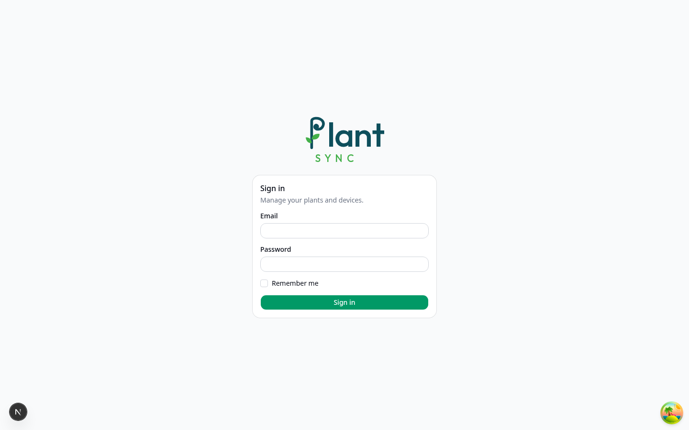

### Dashboard
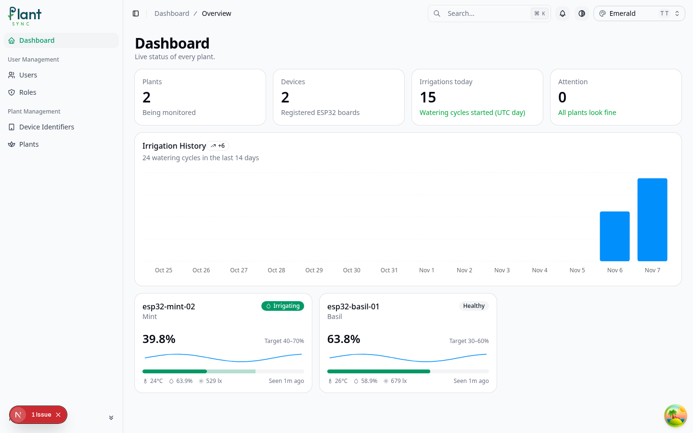

### Plants
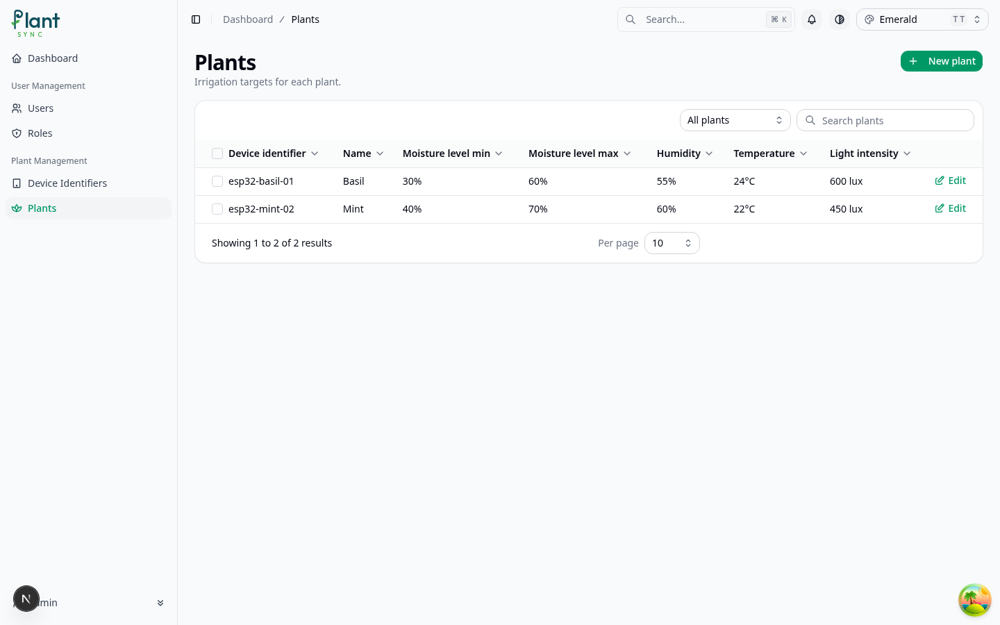

### Plant detail
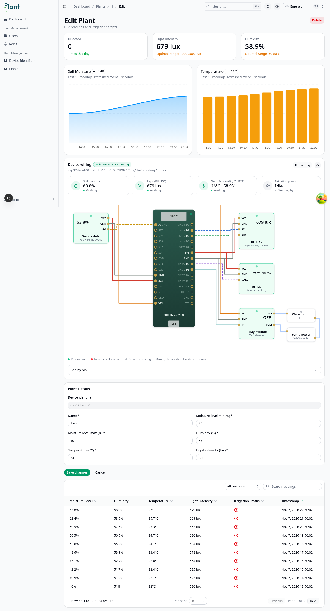

### Device Identifiers
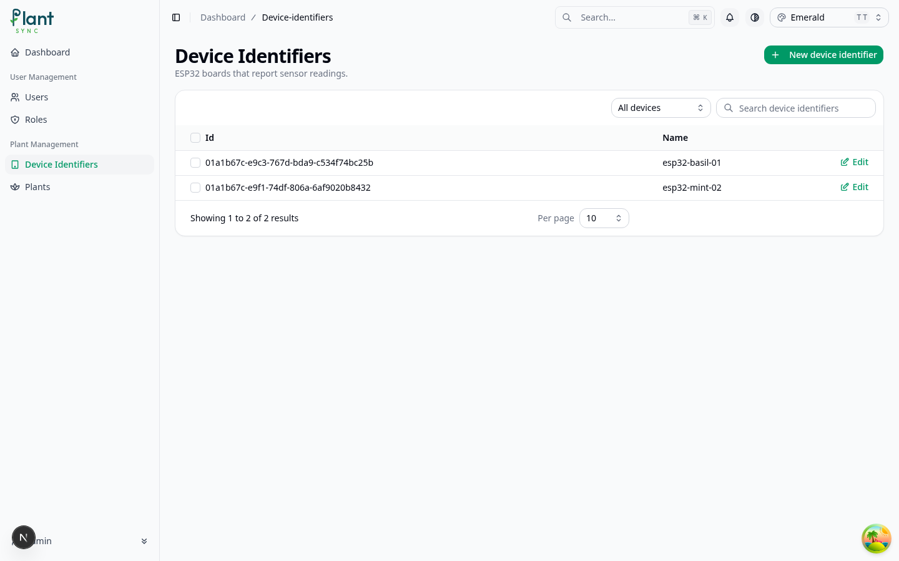

### New device and wiring designer
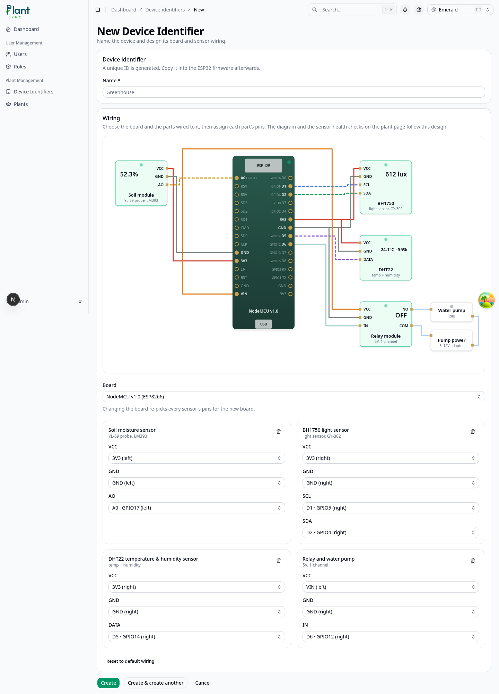

### Users
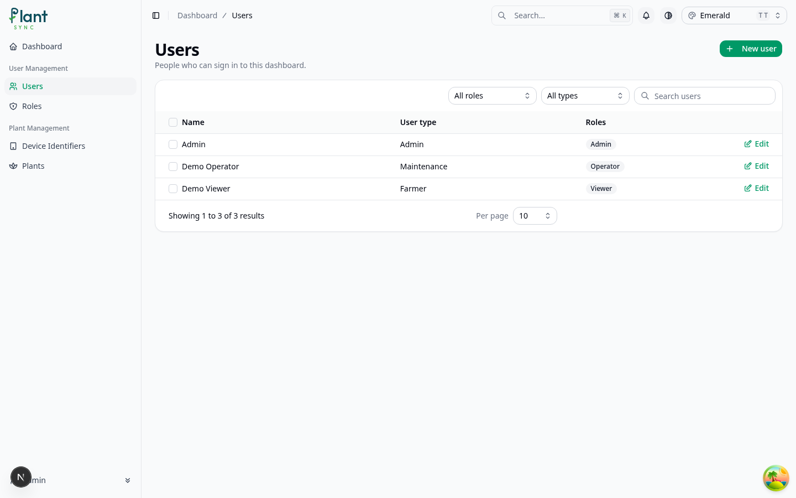

### Roles
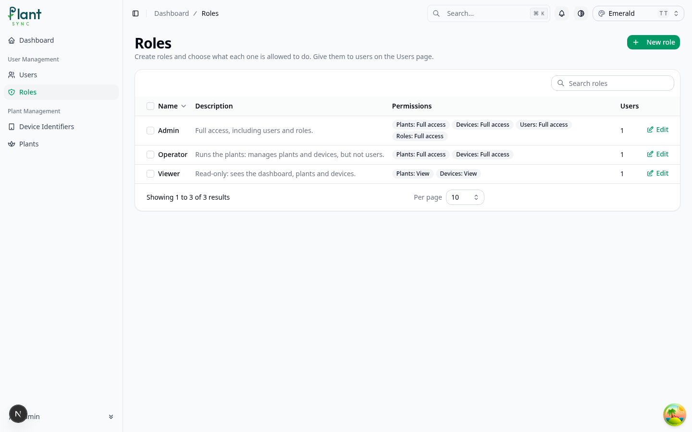

### Profile
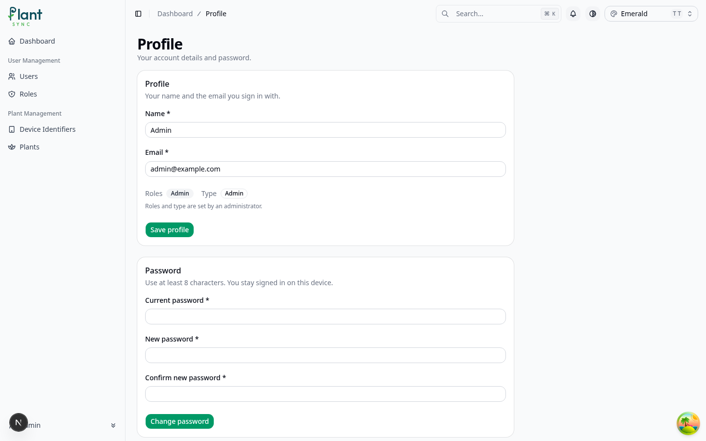
